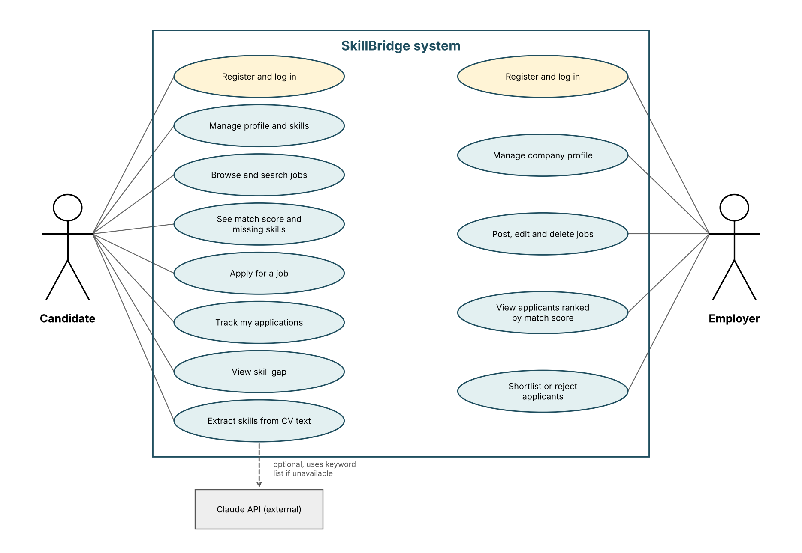

# SkillBridge: users, stories and requirements

## 1. Problem and stakeholders

Job seekers cannot tell how well they fit a job before applying, and they do not
learn which skills they are missing. Employers receive many applications and must
read all of them to find the best fit.

| Stakeholder    | Interest                                       |
| -------------- | ---------------------------------------------- |
| Candidate      | Find jobs that fit, understand gaps, apply     |
| Employer       | Post jobs, see the best applicants first       |
| Platform owner | A secure, reliable system that keeps data safe |

## 2. Example personas

These personas are examples used to guide the design.

**Aoife, 24, recent graduate (candidate).** Applied to many jobs with no replies.
She wants to know which jobs she is realistic for, and what to learn next.

**Sean, 38, hiring manager at a small software company (employer).** Gets about
100 applications per post and has limited time. He wants to see the strongest
candidates first and shortlist quickly.

## 3. User stories

| ID   | As a...   | I want to...                                                 | So that...                                         |
| ---- | --------- | ------------------------------------------------------------ | -------------------------------------------------- |
| US1  | candidate | create an account and log in                                 | my skills and applications are saved               |
| US2  | candidate | add my skills to my profile                                  | the system can compare me with jobs                |
| US3  | candidate | paste my CV text and get skills suggested                    | I do not have to type them all                     |
| US4  | candidate | search and filter jobs                                       | I can find relevant roles quickly                  |
| US5  | candidate | see a match percentage on each job                           | I know how well I fit before applying              |
| US6  | candidate | see which skills I am missing                                | I know what to learn                               |
| US7  | candidate | apply with a cover letter, once per job                      | I can show interest without duplicate applications |
| US8  | candidate | track the status of my applications                          | I know where I stand                               |
| US9  | candidate | see the skills I am missing most across all jobs             | I can plan my learning                             |
| US10 | employer  | post, edit and delete my jobs with required skills           | candidates can be matched to them                  |
| US11 | employer  | see applicants ranked by match score                         | I review the best fits first                       |
| US12 | employer  | shortlist or reject applicants                               | I can manage my hiring                             |
| US13 | any user  | be sure other people cannot use my account or change my data | my information stays safe                          |

## 4. Functional requirements

See Section 2.2 of the technical report (FR1 to FR12). Each user story above maps to at least one of them.

## 5. Non-functional requirements

| Area            | Requirement                                                                                                          |
| --------------- | -------------------------------------------------------------------------------------------------------------------- |
| Security        | Hashed passwords, role checks on the server, input validation, rate limiting, secrets outside the code               |
| Usability       | A first-time user understands the match result without help                                                          |
| Accessibility   | Keyboard navigation, skip link, labelled forms, text contrast of at least 4.5:1, meaning never shown by colour alone |
| Responsiveness  | Works on phone, tablet and desktop widths                                                                            |
| Reliability     | Clear error messages, no crash on bad input, optional AI feature has a backup                                        |
| Maintainability | Layered code (routes, controllers, services, models), linted and formatted                                           |
| Performance     | Pages load jobs in one request, search text is limited in length                                                     |

## 6. Use-case diagram

## 7. Out of scope (future work)

CV file upload, email notifications, weighting of important skills, real-time updates.
